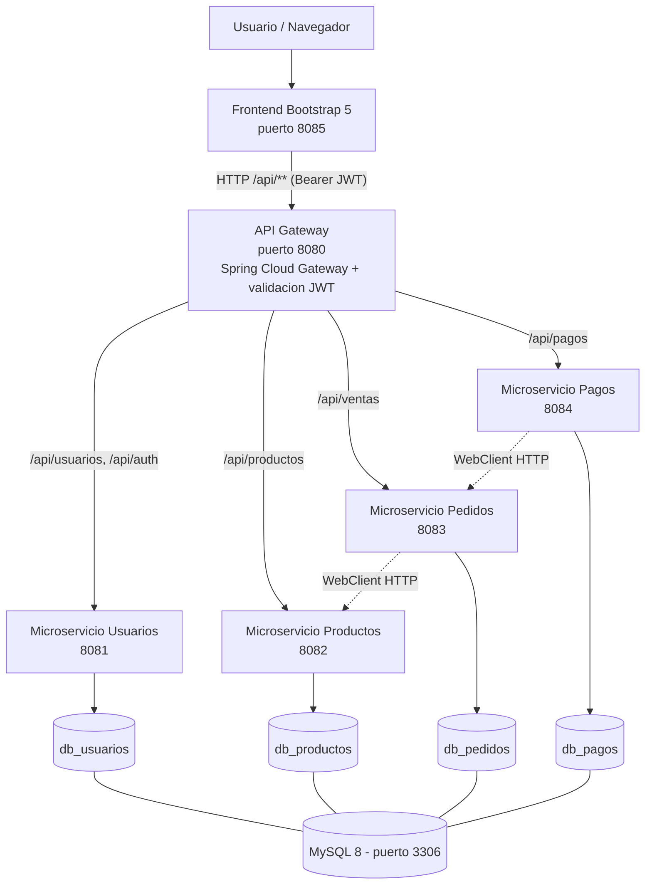
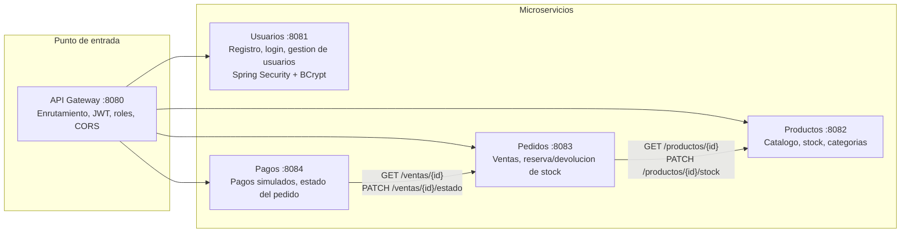
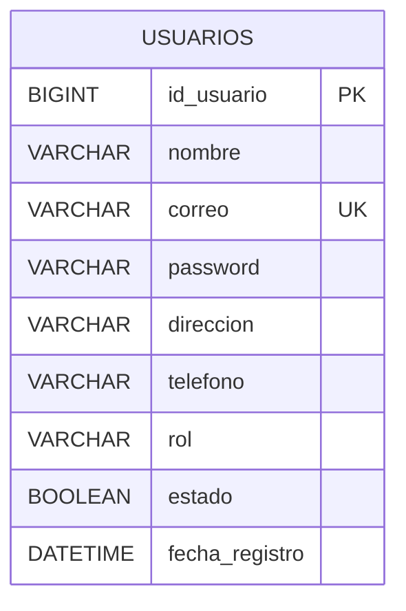
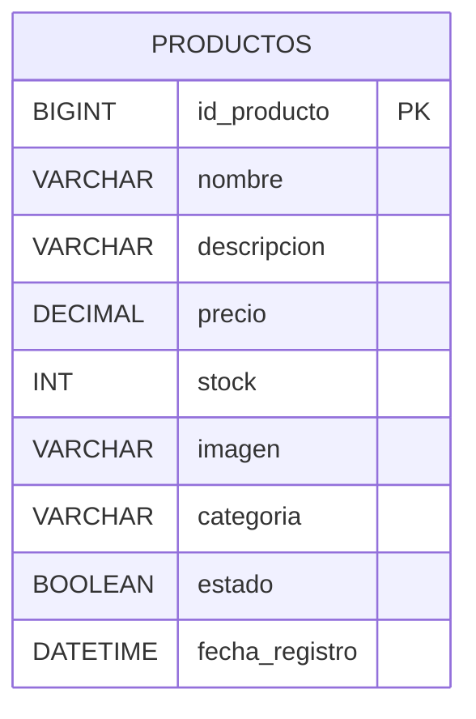
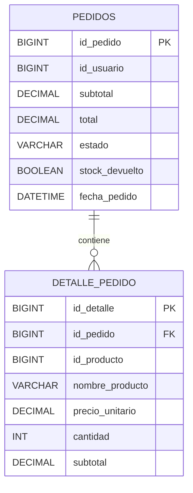
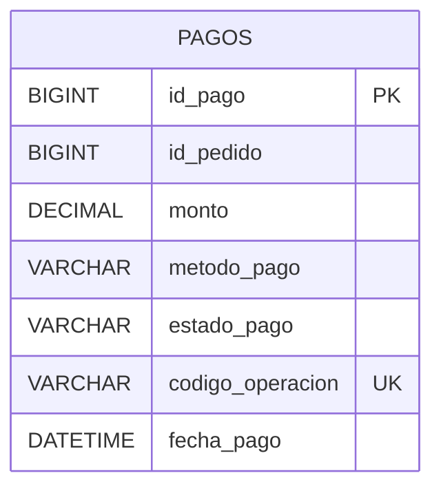
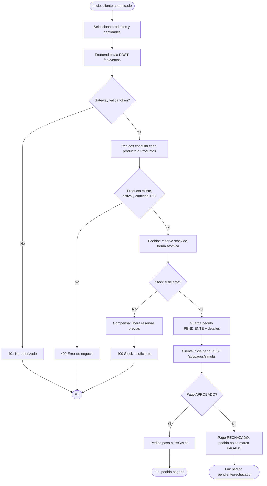
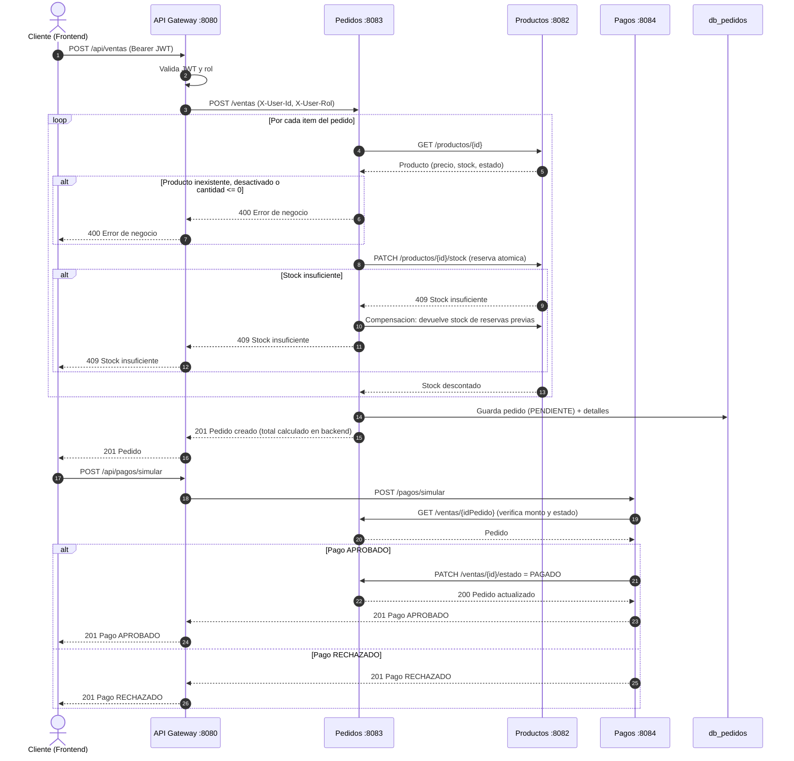
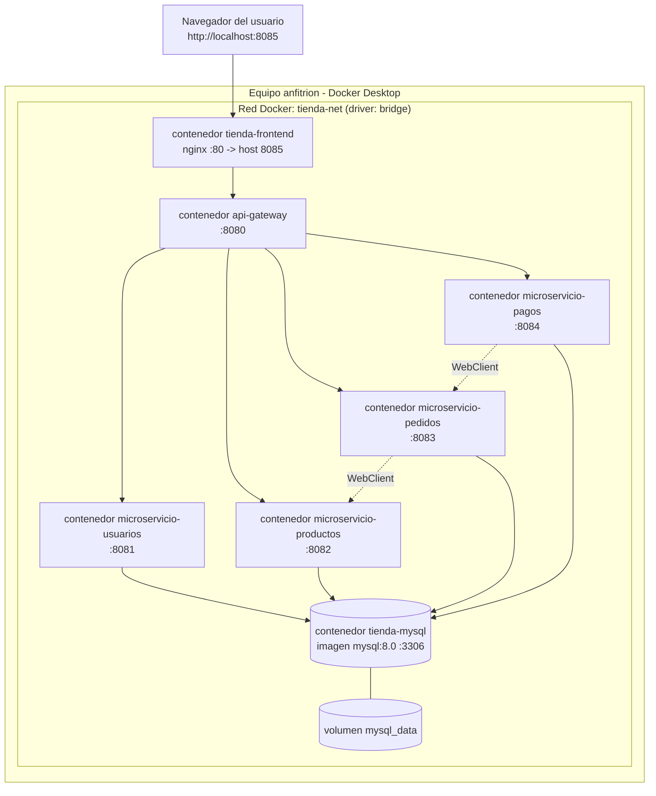

# Documentación Técnica — Tienda Virtual (Microservicios)

Documento técnico del sistema **Tienda Virtual**: arquitectura, diagramas, detalle de cada microservicio, seguridad, comunicación y compensación entre servicios, reglas de negocio, casos de prueba y limitaciones.

> Para la instalación y ejecución paso a paso, consultar el [`README.md`](README.md).

---

## 1. Arquitectura de microservicios

El sistema sigue un estilo de **microservicios** con las siguientes decisiones de diseño:

- **Punto único de entrada (API Gateway):** todo el tráfico del frontend entra por `api-gateway` (puerto 8080). El gateway enruta cada petición al microservicio correspondiente aplicando el filtro `StripPrefix=1` (elimina el prefijo `/api`).
- **Base de datos por servicio (database-per-service):** cada microservicio gestiona su propio esquema (`db_usuarios`, `db_productos`, `db_pedidos`, `db_pagos`). No hay claves foráneas físicas entre bases; las referencias son **lógicas**.
- **Seguridad centralizada:** el gateway valida el **JWT** y el **rol** de cada petición. Los servicios reciben la identidad resuelta mediante las cabeceras `X-User-Id` y `X-User-Rol`.
- **Comunicación entre servicios:** síncrona vía HTTP con **WebClient** (pedidos → productos y pagos → pedidos).
- **Despliegue:** empaquetado en contenedores Docker sobre una red bridge `tienda-net`.

### Rol del API Gateway

El API Gateway (`Spring Cloud Gateway`, Spring Cloud 2023.0.1) cumple tres funciones:

1. **Enrutamiento:** dirige `/api/**` hacia el microservicio correcto mediante rutas declarativas con URI directa (no usa Eureka ni `lb://`).
2. **Seguridad:** un `GlobalFilter` (`JwtAuthFilter`, orden `-1`, se ejecuta antes del enrutamiento) valida el token y el rol de forma centralizada:
   - Las peticiones `OPTIONS` (preflight CORS) pasan sin validación.
   - Las **rutas públicas** pasan sin token.
   - Las **rutas solo ADMIN** exigen un token válido con `rol=ADMIN` (si no → **403**).
   - El **resto** exige un token válido de cualquier rol (si falta o expira → **401**).
3. **Propagación de identidad:** inyecta `X-User-Id` y `X-User-Rol` a partir de los *claims* del JWT para que los servicios downstream conozcan al usuario.
4. **CORS:** estrategia única centralizada en `globalcors` del gateway (no se registran filtros CORS adicionales).

---

## 2. Diagramas

### 2.1 Diagrama general de arquitectura



### 2.2 Diagrama de microservicios con responsabilidades



### 2.3 Diagramas entidad-relación por base de datos

**a) `db_usuarios` — microservicio-usuarios**



**b) `db_productos` — microservicio-productos**



**c) `db_pedidos` — microservicio-pedidos**



**d) `db_pagos` — microservicio-pagos**



### 2.4 Diagrama UML de actividades — proceso de compra



### 2.5 Diagrama de secuencia — proceso de pedido (con compensación y pago)



> **Nota sobre cancelación:** al cambiar el estado de un pedido a `CANCELADO` (vía `PATCH /api/ventas/{id}/estado`, solo ADMIN), el microservicio de pedidos devuelve a Productos el stock reservado **una sola vez**, protegido por la bandera `stockDevuelto`.

### 2.6 Diagrama de despliegue Docker



> Los contenedores se comunican entre sí por **nombre de servicio** dentro de `tienda-net` (por ejemplo `http://microservicio-productos:8082`), mientras que desde el anfitrión se accede por `localhost` y los puertos publicados.

---

## 3. Detalle de cada microservicio

### 3.1 `api-gateway` (puerto 8080)

- **Responsabilidad:** punto único de entrada; enrutamiento, validación JWT/roles y CORS.
- **Endpoints públicos de gestión:** `/actuator/health`, `/actuator/info`, `/actuator/gateway`.
- **Base de datos:** ninguna (es stateless).
- **Seguridad:** `JwtAuthFilter` (GlobalFilter).

### 3.2 `microservicio-usuarios` (puerto 8081, `db_usuarios`, tabla `usuarios`)

- **Responsabilidad:** registro, autenticación (emisión de JWT) y gestión de usuarios.
- **Seguridad:** Spring Security + BCrypt + JWT; filtro `JwtAuthenticationFilter`.
- **Endpoints (ruta del servicio):**

| Método | Ruta | Acceso | Descripción |
|---|---|---|---|
| POST | `/usuarios` | Público | Registrar usuario |
| POST | `/auth/login` | Público | Login; devuelve token JWT |
| GET | `/usuarios` | ADMIN | Listar usuarios |
| GET | `/usuarios/{id}` | ADMIN | Consultar usuario |
| PUT | `/usuarios/{id}` | ADMIN | Actualizar usuario |
| PATCH | `/usuarios/{id}/estado` | ADMIN | Activar/desactivar usuario |

- **Inicialización:** `DataInitializer` crea administrador y cliente demo con BCrypt al arrancar.

### 3.3 `microservicio-productos` (puerto 8082, `db_productos`, tabla `productos`)

- **Responsabilidad:** catálogo de productos, consulta de disponibilidad y control de stock.
- **Endpoints (ruta del servicio):**

| Método | Ruta | Acceso | Descripción |
|---|---|---|---|
| GET | `/productos?nombre=&categoria=` | Público | Listar / buscar productos |
| GET | `/productos/{id}` | Público | Consultar producto |
| GET | `/productos/categorias` | Público | Listar categorías |
| POST | `/productos` | ADMIN | Crear producto |
| PUT | `/productos/{id}` | ADMIN | Actualizar producto |
| PATCH | `/productos/{id}/stock` | ADMIN | Fijar stock (soporta decremento/compensación atómica) |
| DELETE | `/productos/{id}` | ADMIN | Baja lógica (`estado=false`) |

### 3.4 `microservicio-pedidos` (puerto 8083, `db_pedidos`, tablas `pedidos` y `detalle_pedido`)

- **Responsabilidad:** registro de pedidos/ventas, cálculo de subtotales/totales en backend, reserva y devolución de stock, y transición de estados.
- **Comunicación:** consume `microservicio-productos` vía WebClient para precios, validación y reserva de stock.
- **Endpoints (ruta del servicio):**

| Método | Ruta | Acceso | Descripción |
|---|---|---|---|
| POST | `/ventas` | Autenticado | Crear pedido |
| GET | `/ventas` | ADMIN | Listar todos los pedidos |
| GET | `/ventas/{id}` | Autenticado | Consultar pedido |
| GET | `/ventas/usuario/{idUsuario}` | Autenticado | Pedidos de un usuario |
| PATCH | `/ventas/{id}/estado` | ADMIN | Cambiar estado (PENDIENTE, PAGADO, RECHAZADO, CANCELADO, ENTREGADO) |

### 3.5 `microservicio-pagos` (puerto 8084, `db_pagos`, tabla `pagos`)

- **Responsabilidad:** registrar pagos **simulados**, determinar aprobación/rechazo y actualizar el estado del pedido.
- **Comunicación:** consume `microservicio-pedidos` vía WebClient para verificar el pedido y actualizar su estado.
- **Endpoints (ruta del servicio):**

| Método | Ruta | Acceso | Descripción |
|---|---|---|---|
| POST | `/pagos/simular` | Autenticado | Simular pago |
| GET | `/pagos/{id}` | Autenticado | Consultar pago |
| GET | `/pagos/pedido/{idPedido}` | ADMIN | Listar pagos de un pedido |

---

## 4. Seguridad

### 4.1 Autenticación y JWT

- El login es `POST /api/auth/login`; el servicio de usuarios valida las credenciales con **BCrypt** y emite un **JWT HS256** firmado con `JWT_SECRET`.
- **Claims del token:** `sub` (correo), `idUsuario`, `nombre`, `rol`.
- **Expiración:** configurable con `JWT_EXPIRATION` (por defecto `86400000` ms = 24 h).
- El cliente envía el token en la cabecera `Authorization: Bearer <JWT>`.

### 4.2 Cifrado de contraseñas

- Las contraseñas se almacenan cifradas con **BCrypt**. Los usuarios iniciales se crean mediante `DataInitializer` para garantizar el hash correcto.

### 4.3 Roles

| Rol | Descripción |
|---|---|
| `ADMIN` | Gestión de catálogo, usuarios, listado de ventas, cambio de estado y consulta de pagos |
| `CLIENTE` | Registro, login, compra, consulta de sus pedidos y simulación de pagos |

### 4.4 Validación en el gateway y protección de rutas

- **Públicas:** `POST /api/usuarios`, `POST /api/auth/login`, `GET /api/productos/**`, `/actuator/**`.
- **Solo ADMIN:** `POST|PUT|PATCH|DELETE /api/productos/**`; `GET|PUT|PATCH|DELETE /api/usuarios/**`; `GET /api/ventas` (listado completo); `PATCH /api/ventas/**`; `GET /api/pagos/**`.
- **Resto (token de cualquier rol):** `POST /api/ventas`, `GET /api/ventas/{id}`, `GET /api/ventas/usuario/{idUsuario}`, `POST /api/pagos/simular`. Las consultas de pagos (`GET /api/pagos/**`) quedan restringidas a ADMIN.
- **Códigos:** **401** si falta o expira el token; **403** si el rol es insuficiente.

### 4.5 Identidad propagada a los servicios

El gateway inyecta `X-User-Id` y `X-User-Rol`. Los servicios de productos, pedidos y pagos **confían** en estas cabeceras. Por seguridad, estos servicios **no deben exponerse directamente a Internet** (ver *Limitaciones*).

### 4.6 Variables de entorno relevantes

| Variable | Descripción | Valor por defecto (`.env.example`) |
|---|---|---|
| `MYSQL_ROOT_PASSWORD` | Contraseña root de MySQL | `rootpass` |
| `MYSQL_USER` / `MYSQL_PASSWORD` | Usuario de aplicación | `tienda` / `tienda123` |
| `JWT_SECRET` | Clave de firma del JWT (≥ 32 caracteres) | `ClaveSecretaSuperSeguraParaLaTiendaVirtual2025CambiarEnProduccion` |
| `JWT_EXPIRATION` | Expiración del token (ms) | `86400000` |
| `ADMIN_NOMBRE` / `ADMIN_CORREO` / `ADMIN_PASSWORD` | Administrador inicial | `Administrador General` / `admin@tienda.com` / `Admin123` |
| `USUARIOS_URI`, `PRODUCTOS_URI`, `PEDIDOS_URI`, `PAGOS_URI` | URIs de destino del gateway | `http://localhost:808x` |

---

## 5. Comunicación entre microservicios

### 5.1 WebClient

La comunicación es **síncrona** mediante `WebClient`:

- `microservicio-pedidos` → `microservicio-productos`: obtener producto (precio/stock/estado) y reservar/liberar stock.
- `microservicio-pagos` → `microservicio-pedidos`: verificar el pedido y actualizar su estado a `PAGADO`.

En Docker, las URIs se resuelven por nombre de servicio (`http://microservicio-productos:8082`, `http://microservicio-pedidos:8083`); en local, por `localhost`.

### 5.2 Flujo de compra paso a paso

1. El cliente envía `POST /api/ventas` con `idUsuario` e `items` (`idProducto`, `cantidad`).
2. El gateway valida el JWT y propaga `X-User-Id` / `X-User-Rol`.
3. Pedidos consulta cada producto en Productos para obtener **precio real** y verificar que **exista, esté activo y haya stock**.
4. Pedidos **reserva** el stock de forma **atómica** en Productos (el stock no puede quedar negativo).
5. Pedidos calcula `subtotal` y `total` **en el backend** y guarda el pedido en estado `PENDIENTE`.
6. El cliente simula el pago con `POST /api/pagos/simular`.
7. Pagos verifica el pedido y decide aprobar o rechazar. Si aprueba, actualiza el pedido a `PAGADO`.
8. Si el pedido se **cancela**, Pedidos devuelve el stock reservado (una sola vez).

### 5.3 Mecanismo de compensación actual

Como no hay transacciones distribuidas, Pedidos implementa una **compensación manual** durante la creación del pedido:

- Cada reserva de stock exitosa se registra en memoria (clase interna `Reserva`).
- Si **falla** la reserva de un ítem posterior (stock insuficiente, servicio caído, etc.), se **liberan las reservas previas** devolviendo el stock.
- Al **cancelar** un pedido ya creado, se devuelve el stock reservado, protegido por la bandera `stockDevuelto` para garantizar que la devolución ocurra **una sola vez**.

Esta lógica es la **base** para evolucionar hacia el patrón **Saga**.

### 5.4 Evolución al patrón Saga

El patrón **Saga** reemplaza la compensación ad-hoc por un flujo de pasos, cada uno con su **acción de compensación** en caso de fallo.

**Orquestación vs. coreografía**

| Aspecto | Coreografía | Orquestación |
|---|---|---|
| Control del flujo | Cada servicio reacciona a eventos; nadie centraliza | Un **orquestador** decide los pasos |
| Acoplamiento | Bajo, pero difícil de seguir | Mayor, pero más claro y testeable |
| Complejidad | Difícil de depurar en flujos largos | Centralizada y auditable |
| Adecuado para | Flujos cortos | Flujos con varias compensaciones (caso de compra) |

Para este sistema (flujo de compra con varios pasos y compensaciones) se recomienda **orquestación**, implementable con un orquestador (por ejemplo en el microservicio de pedidos) o con un motor de sagas.

**Pasos y compensaciones**

| # | Paso (acción) | Servicio | Compensación |
|---|---|---|---|
| 1 | Crear pedido en `PENDIENTE` | Pedidos | Marcar pedido `CANCELADO` |
| 2 | Reservar stock de cada ítem | Productos | Devolver stock reservado (una sola vez) |
| 3 | Confirmar/simular pago | Pagos | Registrar pago `RECHAZADO` / reversar |
| 4 | Marcar pedido `PAGADO` | Pedidos | Volver a `PENDIENTE` o `CANCELADO` |
| 5 | Pasar a `ENTREGADO` (manual) | Pedidos | — (estado final) |

**Ventajas esperadas:**

- Manejo explícito de fallos y **idempotencia** de las compensaciones.
- Mayor trazabilidad (log de pasos y compensaciones).
- Posibilidad de incorporar **Outbox** / colas para desacoplar y garantizar entrega de eventos.

---

## 6. Reglas de negocio

1. No se permiten **cantidades <= 0**.
2. No se permiten pedidos con **productos inexistentes**.
3. No se permiten compras **superiores al stock**; el stock se descuenta de forma **atómica** (no puede quedar negativo).
4. Los **precios y totales** se calculan **siempre en el backend** a partir del microservicio de productos (nunca se confía en el precio enviado por el navegador).
5. Los **productos desactivados** no pueden comprarse.
6. Cada pedido tiene **identificador único** y **fecha/hora**.
7. El **pago lo determina** el microservicio de pagos (simulado); un pedido **no se marca `PAGADO`** si el pago fue rechazado.
8. Al **cancelar** un pedido se devuelve el stock reservado **una sola vez** (bandera `stockDevuelto`).
9. **Compensación:** si al crear un pedido falla la reserva de un ítem, se **liberan las reservas previas** (base para evolucionar a patrón Saga).

---

## 7. Casos de prueba

> **Importante:** los siguientes casos describen el **comportamiento esperado**. **No se ejecutaron pruebas de integración end-to-end con MySQL real**; las validaciones realizadas se limitan a la **compilación del código**. Los casos quedan listos para ser ejecutados (por ejemplo, con la colección Postman `postman/tienda-virtual-collection.json`).

| # | Caso | Acción | Resultado esperado |
|---|---|---|---|
| 1 | **Stock insuficiente** | `POST /api/ventas` con una cantidad mayor al stock disponible | Error de negocio (p. ej. 409); el pedido **no** se crea y **no** queda stock descontado |
| 2 | **Cantidad <= 0** | `POST /api/ventas` con `cantidad: 0` o negativa | Error de negocio (400); no se crea el pedido |
| 3 | **Producto desactivado** | `POST /api/ventas` con un producto con `estado=false` | Error de negocio; el pedido **no** se crea |
| 4 | **Precio manipulado desde el frontend** | Enviar un `precio` alterado (o enviar solo `idProducto`/`cantidad`) | El backend **ignora** el precio del cliente y calcula el total con el precio real de Productos |
| 5 | **Pago rechazado** | `POST /api/pagos/simular` con `TARJETA_PRUEBA` y `numeroTarjeta: "4111111111110000"` (o `simularResultado: "RECHAZADO"`) | Respuesta con `estadoPago=RECHAZADO`; el pedido **no** se marca `PAGADO` |
| 6 | **Cancelación con devolución única de stock** | `PATCH /api/ventas/{id}/estado` con `estado=CANCELADO` (ADMIN) | Se devuelve el stock **una sola vez**; `stockDevuelto=true`; una segunda cancelación **no** vuelve a devolver stock |
| 7 | **Compra simultánea** | Dos pedidos concurrentes que en conjunto superan el stock | Solo se confirman los que caben en el stock disponible; el stock nunca queda negativo (descuento atómico) |
| 8 | **Sin token / token expirado** | Llamar a una ruta protegida sin token o con token vencido | **401 No autorizado** |
| 9 | **Rol insuficiente** | Llamar a una ruta ADMIN con token de `CLIENTE` | **403 Acceso denegado** |
| 10 | **Login correcto** | `POST /api/auth/login` con credenciales válidas | **200** con `token`, `tipo`, `idUsuario`, `nombre`, `correo`, `rol` |

---

## 8. Instalación, configuración y ejecución

Consultar el **[`README.md`](README.md)**, secciones:

- **6. Instalación y ejecución paso a paso (Windows 10/11)** — con Docker y sin Docker.
- **7. Credenciales de prueba**.
- **8. Puertos utilizados**.
- **10. Ejecución de la colección Postman**.
- **11. Detener el sistema y consultar logs**.

Resumen rápido (con Docker):

```powershell
cd tienda-virtual
copy .env.example .env
docker compose up --build
```

---

## 9. Limitaciones conocidas y trabajo futuro

### 9.1 Limitaciones conocidas

1. **Java:** el proyecto está configurado y compilado con **Java 21** (`mvnw clean package -DskipTests` → **BUILD SUCCESS**). Los 5 módulos usan `<java.version>21</java.version>` y los `Dockerfile` compilan/ejecutan con Temurin 21 (`maven:3.9.6-eclipse-temurin-21` y `eclipse-temurin:21-jre-alpine`).
2. **Docker no estaba instalado** en el entorno de desarrollo: `docker compose up --build` **no pudo ejecutarse ni verificarse**. Los `Dockerfile` y el `docker-compose.yml` se entregan listos, **pendientes de validación** en un equipo con Docker Desktop.
3. Los scripts SQL de `database/` se ejecutan **automáticamente** la primera vez que Docker crea el volumen de MySQL (montaje en `/docker-entrypoint-initdb.d`). Si el volumen ya existe, no se re-ejecutan.
4. Los microservicios de **productos, pedidos y pagos confían en las cabeceras `X-User-Id` y `X-User-Rol`** inyectadas por el gateway; las validaciones de rol se centralizan en el **API Gateway** y en el **microservicio de usuarios** (que sí implementa Spring Security). Se recomienda **no exponer** esos servicios directamente a Internet.
5. Los **pagos son simulados**; no hay pasarelas bancarias reales.
6. **No se ejecutaron pruebas de integración end-to-end con MySQL real**; las validaciones realizadas se limitan a la **compilación del código**.

### 9.2 Trabajo futuro

- **Seguridad entre servicios:** evolucionar de `X-User-Id`/`X-User-Rol` a **OAuth2** y/o **mTLS** con tokens de servicio, de modo que cada microservicio valide el origen (no solo confíe en cabeceras).
- **Patrón Saga** (orquestación) con compensaciones idempotentes y trazabilidad de pasos.
- **Mensajería asíncrona** (colas/eventos, patrón **Outbox**) para desacoplar pedidos, pagos e inventario.
- **Service discovery** (Eureka/Consul) y balanceo de carga en lugar de URIs directas.
- **Observabilidad:** trazas distribuidas (OpenTelemetry), métricas y *health checks* de negocio.
- **Pruebas automatizadas:** unitarias e integración (Testcontainers con MySQL real) y pruebas end-to-end.
- **Gestión de configuración** centralizada (Spring Cloud Config) y secretos gestionados de forma segura.
- **Frontend** integrado con el flujo completo de compra y pago, con manejo de errores por código HTTP.

---

## 10. Contexto académico

Proyecto desarrollado como **taller académico de arquitectura de microservicios**, con el objetivo de demostrar: separación de responsabilidades, base de datos por servicio, seguridad centralizada con JWT en un API Gateway, comunicación entre servicios con WebClient, consistencia de datos mediante reserva/devolución de stock y despliegue reproducible con Docker Compose.
